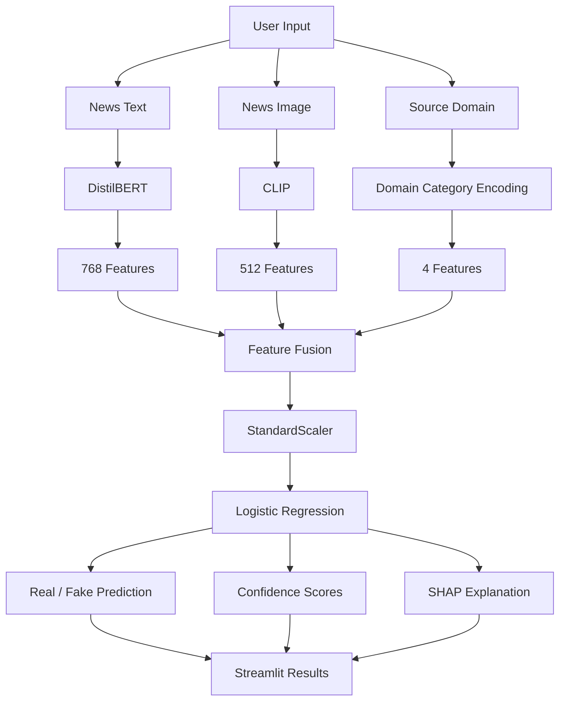

## 📌 Project Overview

Fake news spreads rapidly through digital platforms and social media, making it difficult for users to distinguish authentic information from misleading content.

This project proposes a multimodal fake news detection framework that analyzes three different information sources:

- **Text Analysis:** Uses DistilBERT to extract contextual information from news headlines and text.
- **Image Analysis:** Uses CLIP to extract visual representations from uploaded news images.
- **Source-Domain Analysis:** Uses predefined domain categories to provide additional source-related information.

The extracted features are combined using a Logistic Regression-based fusion classifier to predict whether the submitted news is Real or Fake.

The application also integrates SHAP (SHapley Additive exPlanations) to explain how text, image, and domain features influence model predictions.

## 🎯 Problem Statement

Traditional fake news detection systems primarily focus on textual information and may overlook important visual and source-related signals.

The objective of this project is to develop a multimodal framework that:

- Analyzes both textual and visual news information.
- Incorporates source-domain category features.
- Combines multiple modalities for classification.
- Provides Real/Fake predictions with confidence scores.
- Explains model predictions using Explainable AI.
- Provides recommendations for independent news verification.

## 🛠️ Technologies Used

| Category | Technologies |
|---|---|
| Programming Language | Python |
| Development Environment | Jupyter Notebook, VS Code |
| Frontend | Streamlit |
| Text Processing | DistilBERT, Hugging Face Transformers |
| Image Processing | CLIP, PIL, PyTorch |
| Machine Learning | Scikit-learn |
| Explainable AI | SHAP |
| Data Processing | NumPy, Pandas |
| Model Storage | Joblib |
| Version Control | Git, GitHub |

## 🏗️ System Architecture

The proposed framework consists of five major stages.

### 1. Input Collection
The user provides:
- News headline or article text.
- Related news image.
- Optional source domain.

### 2. Feature Extraction

**Text Feature Extraction – DistilBERT**

- Uses pretrained `distilbert-base-uncased`.
- Extracts the CLS token representation.
- Generates a 768-dimensional text feature vector.

**Image Feature Extraction – CLIP**

- Uses pretrained `openai/clip-vit-base-patch32`.
- Extracts visual representations from the uploaded image.
- Generates a 512-dimensional image feature vector.

**Source-Domain Features**

- Categorizes the provided domain into predefined groups:
  - Image Hosting
  - News Publisher
  - Unknown
  - Other
- Converts the category into a 4-dimensional one-hot encoded vector.

### 3. Multimodal Feature Fusion

The three feature representations are concatenated:

`768 (Text) + 512 (Image) + 4 (Domain) = 1284 Features`

### 4. Classification

The combined feature vector is passed through:

- StandardScaler
- Logistic Regression classifier

The classifier predicts one of two classes:
- 0 – Real News
- 1 – Fake News

### 5. Explainable AI

SHAP is used to calculate modality-level contributions and explain how text, image, and domain information influence the prediction.

### Architecture Diagram



## 📊 Dataset Information

This project uses the **Fakeddit multimodal fake news dataset**.

Dataset source: [Fakeddit Official GitHub Repository](https://github.com/entitize/Fakeddit)

The dataset provides information such as:
- News titles and text.
- Image URLs.
- Source domains.
- Labels.
- Additional metadata.

### Dataset Preparation

The project uses selected balanced subsets for model development and evaluation.

| Dataset | Samples |
|---|---:|
| Training subset | 20,000 |
| Validation subset | 10,000 |
| Test subset | 10,000 |
| Image training subset | 1,889 |

The independent test evaluation used 9,443 samples with successfully downloaded images.

**Note:** The source-domain feature represents predefined domain categories, not independently verified website credibility scores.

## 📈 Model Performance

The final multimodal model was evaluated on 9,443 independent test samples.

### Final Model Results

| Evaluation Metric | Score |
|---|---:|
| Accuracy | 82.84% |
| Precision | 83.01% |
| Recall | 81.97% |
| F1-Score | 82.49% |

### Ablation Study

The following experiment compares the contribution of different modalities on the same independent test set.

| Model Configuration | Accuracy | F1-Score |
|---|---:|---:|
| Text Only | 74.98% | 74.54% |
| Image Only | 75.42% | 74.54% |
| Text + Image | 81.77% | 81.38% |
| Text + Image + Domain | **82.84%** | **82.49%** |

The addition of domain-category features improved accuracy by 1.07 percentage points over the Text + Image configuration in this experiment.

## 🧠 Explainable AI – SHAP

The framework integrates SHAP to improve the interpretability of model predictions.

Instead of providing only a Real/Fake classification, the application displays the contribution of three modalities:

- **Text Contribution:** Influence of DistilBERT text features.
- **Image Contribution:** Influence of CLIP image features.
- **Domain Contribution:** Influence of source-domain category features.

### SHAP Interpretation

- Positive SHAP values push the prediction towards Fake News (class 1).
- Negative SHAP values push the prediction towards Real News (class 0).
- Values close to zero indicate little contribution.

The application displays a modality-level contribution chart to help users understand the model's decision.

SHAP values are contribution scores, not percentages of responsibility.

## 💻 Streamlit Application

The project includes an interactive Streamlit application.

### Main Features

- News headline and text input.
- Image upload functionality.
- Optional source-domain input.
- Real/Fake prediction.
- Prediction confidence scores.
- SHAP modality-level explanations.
- Verification and mitigation recommendations.

## 📂 Project Structure

```text
multimodal-fake-news-detection/
│
├── app.py
├── README.md
├── .gitignore
│
├── models/
│   └── corrected_text_image_domain_model.pkl
│
├── data/
│   └── processed/
│       ├── train_20k.csv
│       ├── validation_10k.csv
│       ├── test_10k.csv
│       ├── image_train_1889.csv
│       └── domain_train_corrected.npy
│
├── 01_dataset_analysis.ipynb
├── 02_baseline_model.ipynb
├── 03_distilbert.ipynb
├── 04_image_model.ipynb
├── 05_multimodal_fusion.ipynb
└── 06_source_cretability.ipynb
```

## ⚙️ Installation and Setup

### Prerequisites

- Python 3.11
- Anaconda or Python virtual environment
- Git
- Internet connection for downloading pretrained Hugging Face models

### Step 1: Clone the Repository

```bash
git clone https://github.com/tushar709/multimodal-fake-news-detection.git
```

### Step 2: Navigate to the Project

```bash
cd multimodal-fake-news-detection
```

### Step 3: Create a Virtual Environment

```bash
conda create -n fake_news_pro python=3.11
conda activate fake_news_pro
```

### Step 4: Install Required Libraries

```bash
pip install streamlit torch transformers shap scikit-learn numpy pandas pillow joblib
```

### Step 5: Run the Streamlit Application

```bash
streamlit run app.py
```

### Step 6: Open the Application

Open the following address in your browser:

```text
http://localhost:8501
```

The pretrained DistilBERT and CLIP models are downloaded from Hugging Face when first loaded, if they are not already cached.

## 📸 Application Screenshots

Add your application screenshots to a folder named `screenshots/` and use the following image references.

### 1. Application Interface


### 2. Prediction Result


### 3. SHAP Explainability


### 4. Verification and Mitigation


## ⚠️ Limitations and Future Improvements

### Current Limitations

- The model may produce incorrect predictions for unfamiliar news topics.
- Image and text modalities can sometimes provide conflicting signals.
- Source-domain categories are predefined and are not verified credibility ratings.
- The independent evaluation includes only samples with successfully downloaded images.
- Model confidence does not guarantee factual correctness.

### Future Improvements

- Incorporate larger and more diverse multimodal datasets.
- Improve source credibility analysis using independently verified information.
- Experiment with advanced multimodal fusion architectures.
- Improve robustness against misleading and unrelated images.
- Explore additional explainability methods such as LIME.
- Perform broader external validation and error analysis.
- Investigate early detection of misinformation before widespread sharing.

## 👨‍💻 Author

**Tushar Sen**

Integrated M.Tech – Artificial Intelligence and Machine Learning

VIT Bhopal University

GitHub: [@tushar709](https://github.com/tushar709)

